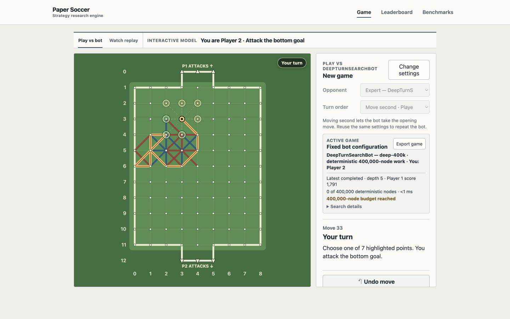
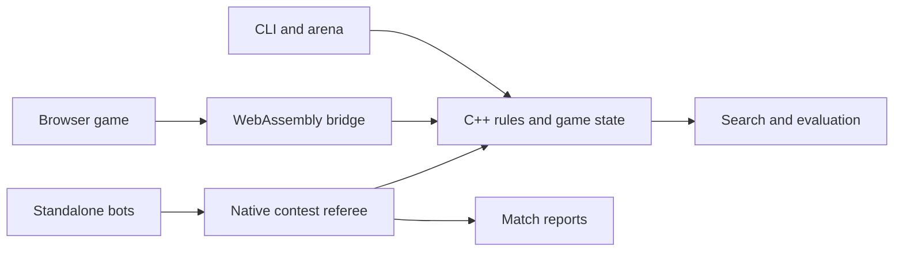

# Paper Soccer Strategy Engine

A C++20 engine for a small game with a surprisingly large search space. Play
paper soccer in the browser, inspect complete-turn decisions, or compare
standalone CodinGame bots with the native match runner.

[](https://github.com/Lecorbio/paper-soccer-strategy-engine/actions/workflows/pages.yml)
[](LICENSE)

**[Play the demo](https://lecorbio.github.io/paper-soccer-strategy-engine/)**
· **[Explore the bots](submissions/codingame/bots/README.md)**
· **[Read the documentation](docs/README.md)**



The [quantized alpha-beta bot](submissions/codingame/bots/quantized_alpha_beta/README.md)
reached **rank 2 of 212 players** on CodinGame, recorded on **9 October 2026**.
The exact standalone source and dated leaderboard evidence are included.

## Inside the engine

Paper soccer adds a twist to ordinary turn-based search: touching a used vertex
or the boundary keeps possession. A single turn can therefore contain a long
sequence of rebounds. The engine searches those complete turns while one shared
rules implementation handles legal moves, goals, and blocked positions.

- **Search:** possession-aware alpha-beta, Monte Carlo tree search, neural
  evaluation, and exact endgame solving.
- **Game Review:** replay validation, complete-turn alternatives, and estimated
  decision quality with separate fast and deep analysis.
- **Contest bots:** 24 standalone implementations, including learned evaluators,
  proof search, and move-ordering experiments.
- **Evaluation:** deterministic openings, color-swapped matches, bounded process
  execution, and reproducible benchmark reports.



The browser and native tools share the same engine. Contest matches run the
actual standalone programs through a referee configured for CodinGame rules. See the
[architecture](docs/architecture.md) for the boundaries and
[algorithms](docs/algorithms.md) for the search details.

## Build and play

For the native engine, install CMake 3.20+ and a C++20 compiler:

```sh
cmake -S . -B build/native -DCMAKE_BUILD_TYPE=Release
cmake --build build/native --target papersoccer_cli papersoccer_tests -j2
ctest --test-dir build/native -R '^papersoccer_tests$' --output-on-failure
./build/native/papersoccer_cli
```

The checked-in WebAssembly modules also let you open `web/index.html` directly
in a browser. The [demo and replay guide](docs/demo-and-replays.md) covers play,
review, and replay export.

The full development suite also needs Node.js 18+, Python 3.12–3.14, Chrome or
Chromium, and the pinned research dependency:

```sh
python3 -m venv .venv
. .venv/bin/activate
python -m pip install -r requirements-research.txt
PAPERSOCCER_BUILD_JOBS=2 ./scripts/build-and-test.sh
```

See [development](docs/development.md) for focused checks and
[reproducibility](docs/reproducibility.md) for toolchains and generated artifacts.

## Results

| Comparison | Recorded result |
| --- | --- |
| [CodinGame](submissions/codingame/bots/quantized_alpha_beta/README.md) | Best observed rank: 2 of 212, on 9 October 2026. |
| [Four-bot study](benchmarks/flagship_study/REPORT.md) | 4,800 games from 2,400 color-swapped opening pairs under demo rules. |
| [Local contest leaderboard](benchmarks/codingame_leaderboard/README.md) | 990 protocol-faithful games across a frozen 22-bot roster. |
| [Game Review evaluation](benchmarks/game_review_gate/REPORT.md) | Selected the deep 400k-node analysis profile with native and WebAssembly checks. |

Platform ranks are dated observations. The local leaderboard uses its own
frozen roster and scoring model; it is a separate measurement. Completed
training experiments, including negative results, are indexed in the
[research archive](docs/archive/README.md).

## Find your way around

| Directory | Contents |
| --- | --- |
| `include/`, `src/` | C++ rules, search, bots, match runners, and browser bridges. |
| `submissions/codingame/bots/` | Standalone contest bots and their tests. |
| `tests/`, `cmake/` | Test suites and build configuration. |
| `tools/`, `scripts/` | Training, data validation, and build tools. |
| `models/`, `benchmarks/` | Model records, benchmark data, and reports. |
| `web/` | Static browser game, review interface, and result pages. |
| `docs/` | Engine guides, development instructions, and research history. |
| `results/` | Local experiment output and selected historical records. |

The [documentation index](docs/README.md) provides four starting points:
**Engine**, **Bots**, **Results**, and **Development**.

## License

Source and documentation are available under the [MIT License](LICENSE).
See [NOTICE](NOTICE.md) for third-party attribution and artifact licenses.
