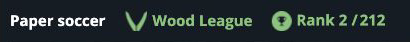

# Quantized alpha-beta

A compact value network guides complete-turn alpha-beta search. This is the
strongest recorded CodinGame bot in the repository: **rank 2 of 212 players**,
observed on **9 October 2026**.



The source is the same bot that completed the
[27 September calibration and local confirmation](history/2026-09-27/README.md).
The later rank is a dated leaderboard observation; it does not represent a new
qualification or win-rate estimate.

## Design

- Complete-turn alpha-beta searches through rebound sequences before handing
  the move to the opponent.
- A bias-free 6,301 → 12 → 8 → 1 value network uses four-bit weights and a
  compact Huffman encoding.
- Exact terminal proofs remain separate from heuristic values. Flat
  goal-distance traversal and corrected proof ranking support the search.

Search budgets are 550 ms for the first decision and 140 ms afterward. The
standalone C++20 source occupies **99,032 ASCII characters**, below the
100,000-character platform limit.

## Build and use

Paste the complete [submission.cpp](submission.cpp) into the CodinGame C++
editor. To build it locally from the repository root:

```sh
cmake -S . -B build -DCMAKE_BUILD_TYPE=Release
cmake --build build --target papersoccer_codingame_quantized_alpha_beta_submission -j2
node submissions/codingame/tools/generate_submission.mjs quantized_alpha_beta --check
```

This is a standalone artifact. Both normal generator invocation and `--check`
verify its encoding, size, and source hash without rewriting the file. Its
exact source SHA-256 is:

```text
78e731a81ce7cc702a200d0832a6c75e967a11b12452051724ab1387c226e4b8
```

## Results and history

The [manifest](manifest.json) preserves the source identity and rank-2
observation. The [earlier results](history/2026-09-27/README.md) include the
completed calibration, paired local confirmation, and experiment report.
Source binding used an independent editor copyback; CodinGame does not expose
a remote source digest.

This bot is compiled and checked with the other submissions. The frozen
22-entrant local leaderboard remains a separate benchmark. The browser demo
uses its own rules and adapter, so platform rankings do not describe browser
performance.
